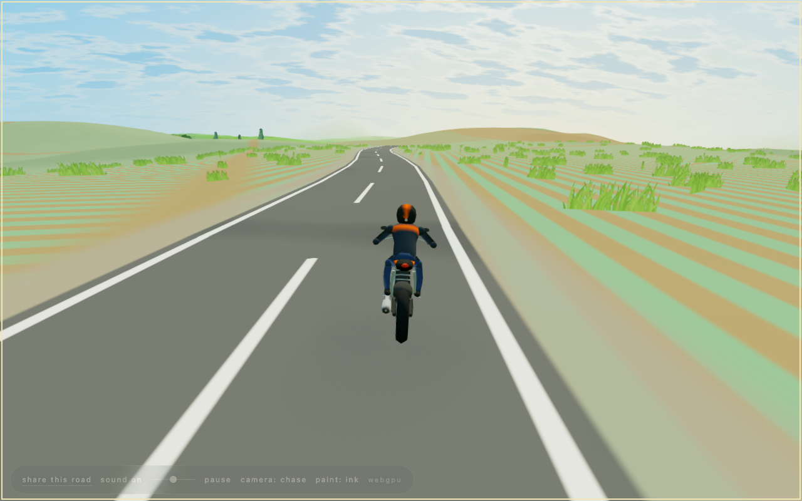

<h1 align="center">The Long Ride</h1>

  

  

<h3 align="center">A motorcycle riding forever through a Northern Mindanao that is made up as you go.</h3>

By Niño Redoble. Open the page and press Begin.

## Using it

- The page opens on a white veil, then stands still behind one **Begin** button; nothing moves and no sound plays until you press it. Sound is synthesized in the browser: a twin's low engine note that follows the bike through its gears, wind that rises with speed, the sea near the coast and a soft chime now and then, with an on/off switch and a volume slider that starts at half.
- Do nothing and the bike rides itself: the road bends with the land, climbs its ridges, skirts the sea, and the day turns through dawn, noon, dusk and a starry night. Drag with the left button to orbit the bike, and the view stays where you leave it; drag with the right button to steer off the road (the bike heads back to it when you let go). The wheel zooms, touch steers, and `C` changes the camera.
- The corner control opens the paint shop: eight colors for the bike. The page remembers your choice.
- **Pause**, or space with the canvas focused, stops the ride and the sound together. A reduced-motion preference starts the page paused.
- The page remembers your sound settings, your framing, and the bike's exact place, course and time of day, and resumes there after Begin. `?seed=<number>` in the address opens that road fresh. The resolved seed is always written into the address, so a copied link takes someone to the same land.
- WebGPU is used when available, over HTTPS or localhost; `?webgl=1` forces WebGL2, and the desktop corner names the backend. Phones get a lighter pass: a smaller render and a shorter view of the trees.

## The world

Four landscapes, mixed by a slow climate that wanders along the road: the **coast** (coconut palms, surf, jade water), the **rice terraces** (flooded and golden paddies stepping with the contours), the **pineapple plateau** (blue-green rows on red earth) and the **highland pines**, with banana groves, mango and rain trees, pasture, nipa huts, stone watchtowers and old churches seen from the road. Everything is generated from the seed on the viewer's machine; nothing is downloaded but Three.js.

## Read on

- [`VISION.md`](VISION.md): what the page is for and the experience it is meant to create.
- [`CONTRIBUTING.md`](CONTRIBUTING.md): how to run, check and publish it, and how to add a biome, a tree, a place or a paint.
- [`AGENTS.md`](AGENTS.md): the engine's rules, for agents and anyone changing `src/`.

## Credit and license

[MIT](LICENSE). The Long Ride is built on the open-source *fly-with-me* engine by Kun Chen, whose copyright line stays in the license beside Niño Redoble's: the renderer, the terrain and streaming machinery, the sky, water and sound are his work, adapted here; the road, the bike, the rider, the Mindanao world and the voice are new. Three.js is loaded from a CDN and carries its own license.
